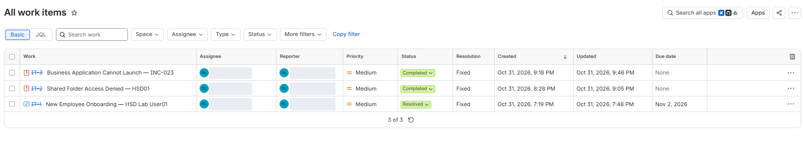
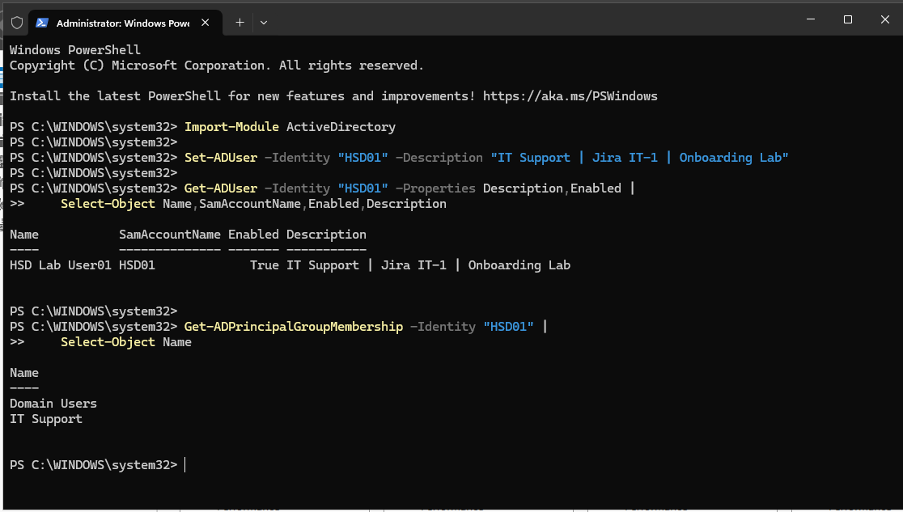
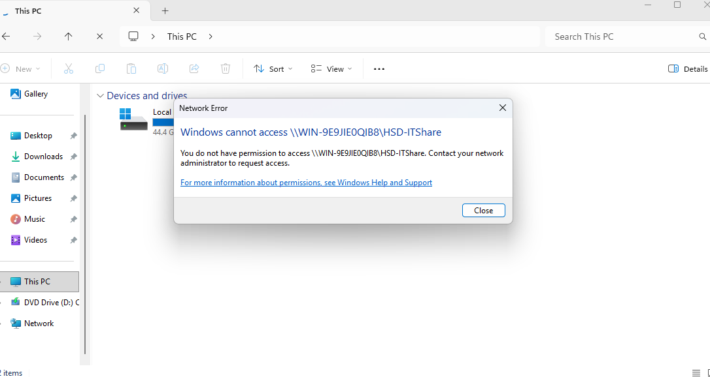
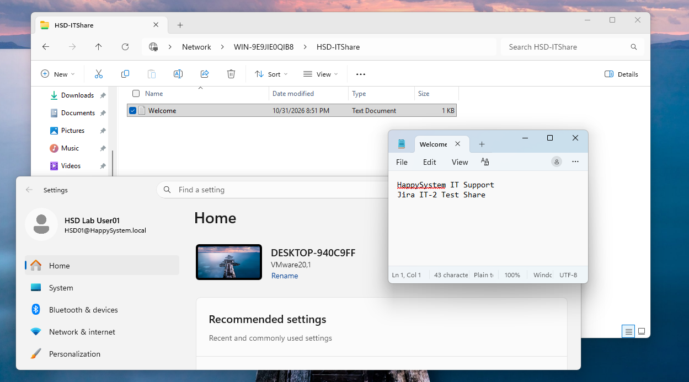

# IT Service Desk Operations Lab

**Jira Service Management · Windows Server 2025 · Active Directory · PowerShell · Windows 11**

An independent, **simulated IT service desk** exercise documenting three tickets through intake, assignment, investigation, verification, and resolution. This project combines Jira ticket handling with controlled Windows and Active Directory tasks in a VMware home lab. It does **not** represent production IT employment or real customer cases.



## Lab environment

| Component | Training environment |
|---|---|
| Ticketing | Jira Service Management Cloud, space **IT Service Project** (ticket keys `IT-1`–`IT-3`) |
| Identity | AD DS / DNS, domain `HappySystem.local` on Windows Server 2025 |
| Clients | Windows 11 VM(s) on an isolated VMware network |
| Account management | Active Directory Users and Computers (ADUC), Windows PowerShell |
| File services | SMB share, AD security groups, NTFS permissions |

## Ticket outcomes

| Ticket | Request / issue | Work performed | Verified outcome |
|---|---|---|---|
| **IT-1** | New employee onboarding | Created test user `HSD01` and a Global Security group `IT Support` in ADUC; added membership; updated the user's description with PowerShell | `Enabled=True`, updated description, and group membership confirmed using AD PowerShell |
| **IT-2** | Shared folder Access Denied | Reproduced the error against an isolated SMB share; compared Share and NTFS permissions; granted missing NTFS Read & Execute access | User `HSD01` opened the share and read `Welcome.txt`; Jira recorded **Completed / Fixed** |
| **IT-3** | Business application unable to launch | Retrospectively documented the **previously completed** INC-023 application-access lab, including NTFS and logon-token findings | Original lab already verified successful launch; Jira recorded **Completed / Fixed** |

### IT-1 — New employee onboarding

A simulated onboarding request was submitted through the Jira customer portal, assigned to the technician, and tracked to resolution. The test OU, user and security group were created **through ADUC**, not via an automated provisioning script. PowerShell was used to update the test account description and verify its state and membership:

```powershell
Import-Module ActiveDirectory
Set-ADUser -Identity 'HSD01' -Description 'IT Support | Jira IT-1 | Onboarding Lab'
Get-ADUser -Identity 'HSD01' -Properties Description,Enabled |
    Select-Object Name,SamAccountName,Enabled,Description
Get-ADPrincipalGroupMembership -Identity 'HSD01' |
    Select-Object Name
```

The output showed `Enabled=True` and membership in `Domain Users` and `IT Support`. The companion file [ad-account-verification.ps1](ad-account-verification.ps1) documents these commands and adds an initial read-only check.

Evidence: [Jira request](screenshots/02-it1-onboarding-request.png) · [AD group membership](screenshots/03-it1-ad-group-membership.png) · [PowerShell verification](screenshots/04-it1-powershell-verification.png)



### IT-2 — Shared folder Access Denied

**Simulated user report:** `HSD01` could not open `\\WIN-9E9JIE0QIB8\HSD-ITShare`.

1. Created an isolated share at `C:\HSD-ITShare` containing `Welcome.txt`.
2. Set **SMB Share Permissions** to allow the `IT Support` security group **Read**.
3. Restricted the test folder's NTFS ACL to administrators and SYSTEM, with no `IT Support` access. Preserved administrator recovery permissions.
4. Reproduced a Windows **permission denied** message on a Windows 11 client.
5. Granted `IT Support` **Read & Execute** NTFS access to the test folder and its contents, without changing the Share permission.
6. Reopened the share as the test user and successfully read `Welcome.txt`.

**Finding:** The SMB Share permission alone did not provide access. The missing NTFS authorization prevented access until the folder ACL was corrected. This exercise verified **read access**, not write access.

| Before | After |
|---|---|
|  |  |

Supporting evidence: [SMB Read permission](screenshots/05-it2-share-read-permission.png) · [Restricted NTFS ACL](screenshots/06-it2-missing-ntfs-access.png) · [Restored NTFS ACL](screenshots/08-it2-restored-ntfs-access.png) · [Jira resolution note](screenshots/10-it2-resolution-note.png)

### IT-3 — Application access incident (retrospective)

This ticket was a **service desk documentation exercise based on an earlier completed simulation**, not a new live outage. The original INC-023 lab involved a domain user unable to launch a desktop shortcut to a test executable. Investigation covered file-level NTFS permissions and whether the expected AD group appeared in the current logon token. Following a fresh sign-in and restoration of Read & Execute rights, the test executable launched under the domain account.

A standalone copy of `cmd.exe` was used as the test application; it displayed a resource-message warning but continued to execute commands. The original incident evidence is part of the separate [IT Support Incident Portfolio](https://github.com/louis00650/IT-Support-Incident-Portfolio).

Evidence: [IT-3 Jira investigation and completed status](screenshots/11-it3-retrospective-resolution.png)

## What this lab demonstrates

- Ticket intake, prioritization, assignment, internal notes and resolution in Jira Service Management.
- Basic on-premises Active Directory user/group administration and PowerShell verification.
- Troubleshooting permission problems across **both SMB Share and NTFS** security layers.
- Documenting findings and validating the outcome before closing an incident.
- Distinguishing **newly executed work** from retrospective incident documentation.

## Evidence and privacy

The screenshots in [`screenshots/`](screenshots/) were captured during the home lab. Some personal display names were visually redacted for public sharing; the ticket keys, technical errors, permission settings and test results were not changed. Lab user identities are fictional. No passwords or production user records are included.

**Scope:** This is a focused training project, not a production help desk deployment.
